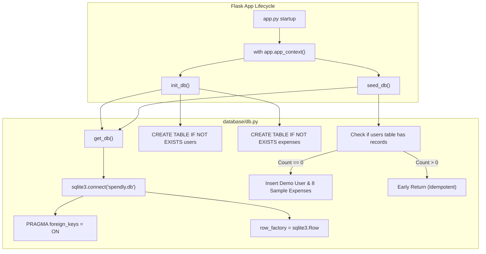

# Implementation Plan: Step 1 — Database Setup

Establish the SQLite data layer for the Spendly expense tracker application, creating tables for users and expenses with foreign key enforcement, row factory mapping, idempotent initialization and seeding, and startup integration with Flask.

---

## User Review Required

> [!NOTE]
> - **Database file**: Default database will be `spendly.db` at the project root (`/home/akshit/PROJECTS/expense-tracker/spendly.db`).
> - **Seeded Credentials**: Demo user will have email `demo@spendly.com` and password `demo123` (hashed with `werkzeug.security.generate_password_hash`).
> - **Dynamic Current Month Seed Dates**: The 8 sample expenses will use the current month and year dynamically (formatted strictly as `YYYY-MM-DD`) with days $\le 28$ so that month-to-date queries and charts in subsequent steps work immediately.

---

## Open Questions

None. The specifications in [`.gemini/specs/01-databse-setup.md`](file:///home/akshit/PROJECTS/expense-tracker/.gemini/specs/01-databse-setup.md) and the architectural constraints in [`GEMINI.MD`](file:///home/akshit/PROJECTS/expense-tracker/GEMINI.MD) provide unambiguous instructions.

---

## Architecture & Data Flow



---

## Proposed Changes

### Data Layer (`database`)

#### [MODIFY] [db.py](file:///home/akshit/PROJECTS/expense-tracker/database/db.py)
Replace the stub in `database/db.py` with the complete SQLite data layer implementation.

- Define fixed categories constant `CATEGORIES`:
  ```python
  CATEGORIES = (
      "Food",
      "Transport",
      "Bills",
      "Health",
      "Entertainment",
      "Shopping",
      "Other",
  )
  ```
- Implement path resolution helper `get_db_path(db_path=None)`:
  - Supports explicit `db_path` (for unit testing with temporary databases).
  - Inspects `flask.current_app.config.get("DATABASE")` if inside an active Flask application context.
  - Falls back to `spendly.db` located at the project root.
- Implement `get_db(db_path=None)`:
  - Connects to SQLite database.
  - Configures `conn.row_factory = sqlite3.Row`.
  - Executes `conn.execute("PRAGMA foreign_keys = ON;")` on every connection.
  - Returns connection.
- Implement `init_db(db_path=None)`:
  - Executes schema creation for `users` and `expenses` tables using `CREATE TABLE IF NOT EXISTS`.
  - Schema details:
    - **`users`**:
      - `id INTEGER PRIMARY KEY AUTOINCREMENT`
      - `name TEXT NOT NULL`
      - `email TEXT UNIQUE NOT NULL`
      - `password_hash TEXT NOT NULL`
      - `created_at TEXT DEFAULT (datetime('now'))`
    - **`expenses`**:
      - `id INTEGER PRIMARY KEY AUTOINCREMENT`
      - `user_id INTEGER NOT NULL REFERENCES users(id) ON DELETE CASCADE`
      - `amount REAL NOT NULL`
      - `category TEXT NOT NULL CHECK (category IN ('Food', 'Transport', 'Bills', 'Health', 'Entertainment', 'Shopping', 'Other'))`
      - `date TEXT NOT NULL`
      - `description TEXT`
      - `created_at TEXT DEFAULT (datetime('now'))`
    - Creates indexes `idx_expenses_user_id` and `idx_expenses_date`.
- Implement `seed_db(db_path=None)`:
  - Checks `SELECT COUNT(*) FROM users`. If `count > 0`, exits immediately.
  - Generates demo password hash with `werkzeug.security.generate_password_hash("demo123")`.
  - Inserts demo user (`Demo User`, `demo@spendly.com`, `password_hash`).
  - Prepares 8 sample expenses covering all 7 categories:
    1. Food: 350.00 (`{YYYY}-{MM}-02`, "Grocery shopping at supermarket")
    2. Transport: 120.50 (`{YYYY}-{MM}-05`, "Metro card recharge")
    3. Bills: 1200.00 (`{YYYY}-{MM}-08`, "Monthly electricity bill")
    4. Health: 450.00 (`{YYYY}-{MM}-12`, "Pharmacy medicines")
    5. Entertainment: 500.00 (`{YYYY}-{MM}-15`, "Movie tickets and snacks")
    6. Shopping: 899.00 (`{YYYY}-{MM}-18`, "New running shoes")
    7. Food: 180.00 (`{YYYY}-{MM}-22`, "Lunch with colleagues")
    8. Other: 250.00 (`{YYYY}-{MM}-25`, "Stationery and desk supplies")
  - Uses parameterized queries (`cursor.executemany(...)`) and commits transaction.

---

### Application Entry Point

#### [MODIFY] [app.py](file:///home/akshit/PROJECTS/expense-tracker/app.py)
- Import `get_db`, `init_db`, `seed_db` from `database.db`.
- Call `init_db()` and `seed_db()` within `with app.app_context():` before running server.
- Preserve all existing routes, placeholders, and configuration (`port=5001`).

```python
# Diff representation:
@@ -1,4 +1,5 @@
 from flask import Flask, render_template
+from database.db import get_db, init_db, seed_db
 
 app = Flask(__name__)
+
+with app.app_context():
+    init_db()
+    seed_db()
```

---

### Tests

#### [NEW] [tests/test_db.py](file:///home/akshit/PROJECTS/expense-tracker/tests/test_db.py)
Create a comprehensive test suite using `pytest`:
- **Fixture `temp_db`**: Yields a temporary database path in `tmp_path` to avoid modifying `spendly.db`.
- **`test_get_db_connection`**: Validates connection, `sqlite3.Row` row factory dictionary access (`row["col"]`), and `PRAGMA foreign_keys = ON`.
- **`test_init_db_creates_tables`**: Verifies `users` and `expenses` tables and columns are created with proper constraints.
- **`test_init_db_idempotency`**: Verifies running `init_db()` repeatedly raises no error.
- **`test_foreign_key_enforcement`**: Verifies inserting an expense with a non-existent `user_id` raises `sqlite3.IntegrityError`.
- **`test_unique_email_constraint`**: Verifies inserting duplicate emails raises `sqlite3.IntegrityError`.
- **`test_category_check_constraint`**: Verifies inserting an expense with an invalid category raises `sqlite3.IntegrityError`.
- **`test_seed_db_data`**: Verifies 1 demo user and 8 sample expenses are inserted, password hash verifies with `check_password_hash`, all 7 categories are present, and dates are formatted as `YYYY-MM-DD`.
- **`test_seed_db_idempotency`**: Verifies repeated calls to `seed_db()` do not duplicate users or expenses.
- **`test_app_startup_integration`**: Verifies starting the app initializes and seeds the database cleanly.

---

## Verification Plan

### Automated Tests
Execute pytest to run the test suite:
```bash
python3 -m pytest -v
```

### Manual Verification
1. Run application startup:
   ```bash
   python3 -c "import app; print('App initialized successfully')"
   ```
2. Verify SQLite database tables and data directly:
   ```bash
   sqlite3 spendly.db "SELECT count(*) FROM users;"
   sqlite3 spendly.db "SELECT count(*) FROM expenses;"
   sqlite3 spendly.db "SELECT id, name, email FROM users;"
   sqlite3 spendly.db "SELECT id, category, amount, date FROM expenses;"
   ```
3. Run subagent verification as mandated by the subagent policy in `GEMINI.MD`:
   - Delegate test execution and result validation to a verification subagent.
