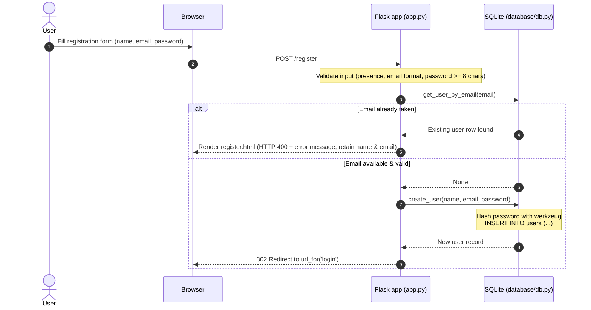

# Implementation Plan: Step 02 — Registration

## Goal Description
Implement user registration for Spendly as specified in [.gemini/specs/02-registration.md](file:///home/akshit/PROJECTS/expense-tracker/.gemini/specs/02-registration.md).
This feature enables new users to register an account using their full name, email address, and password. It establishes account creation and identity verification while upholding the project's strict architecture:
- Database logic isolated to [`database/db.py`](file:///home/akshit/PROJECTS/expense-tracker/database/db.py).
- Single-file routing in [`app.py`](file:///home/akshit/PROJECTS/expense-tracker/app.py) without blueprints.
- Jinja2 templates using `url_for()` without hardcoded URLs.
- Secure password hashing via Werkzeug with parameterized SQL queries.



---

## User Review Required

> [!IMPORTANT]
> **Post-Registration Destination**: Upon successful account creation, the user will be redirected to `url_for('login')` (`/login`). Step 03 implements full login & session management, so the `/login` route currently renders `login.html`.

> [!NOTE]
> **Email Normalization**: Emails will be trimmed of leading/trailing whitespace and lowercased (`email.strip().lower()`) before database lookup and insertion to guarantee case-insensitive uniqueness (e.g. `User@Example.com` matches `user@example.com`).

---

## Open Questions
None. The specifications in `.gemini/specs/02-registration.md` and rules in `GEMINI.md` clearly define the data contract, constraints, and validation rules.

---

## Proposed Changes

### Data Layer

#### [MODIFY] [`database/db.py`](file:///home/akshit/PROJECTS/expense-tracker/database/db.py)
Add data access helpers for querying and creating user records. No SQL or DB logic will be written in route handlers.

- **`get_user_by_email(email: str, db_path=None) -> sqlite3.Row | None`**:
  - Trims and lowercases `email`. Returns `None` if empty.
  - Queries `SELECT * FROM users WHERE email = ?;` with parameterization.
  - Safely closes connection in `finally` block and returns matching `Row` or `None`.
- **`create_user(name: str, email: str, password: str, db_path=None) -> sqlite3.Row`**:
  - Trims `name`, trims and lowercases `email`.
  - Hashes `password` using `generate_password_hash(password)`.
  - Executes `INSERT INTO users (name, email, password_hash) VALUES (?, ?, ?);` inside a connection transaction context (`with conn:`).
  - Fetches and returns the inserted row by `cursor.lastrowid`.

```python
def get_user_by_email(email, db_path=None):
    """Look up an existing user by normalized email."""
    normalized_email = email.strip().lower() if email else ""
    if not normalized_email:
        return None
    conn = get_db(db_path)
    try:
        cursor = conn.cursor()
        cursor.execute("SELECT * FROM users WHERE email = ?;", (normalized_email,))
        return cursor.fetchone()
    finally:
        conn.close()


def create_user(name, email, password, db_path=None):
    """Hash password and insert a new user record using parameterized SQL."""
    normalized_name = name.strip()
    normalized_email = email.strip().lower()
    password_hash = generate_password_hash(password)

    conn = get_db(db_path)
    try:
        with conn:
            cursor = conn.cursor()
            cursor.execute(
                """
                INSERT INTO users (name, email, password_hash)
                VALUES (?, ?, ?);
                """,
                (normalized_name, normalized_email, password_hash),
            )
            user_id = cursor.lastrowid
            cursor.execute("SELECT * FROM users WHERE id = ?;", (user_id,))
            return cursor.fetchone()
    finally:
        conn.close()
```

---

### Route Layer

#### [MODIFY] [`app.py`](file:///home/akshit/PROJECTS/expense-tracker/app.py)
- Import `request`, `redirect`, `url_for` from `flask`.
- Import `re` for email validation regex (`r"^[^@\s]+@[^@\s]+\.[^@\s]+$"`).
- Import `get_user_by_email`, `create_user` from `database.db`.
- Update `/register` route decorator to `methods=["GET", "POST"]`:
  - **`GET`**: Renders `register.html` with HTTP 200.
  - **`POST`**:
    1. Extract and sanitize inputs:
       - `name = request.form.get("name", "").strip()`
       - `email = request.form.get("email", "").strip().lower()`
       - `password = request.form.get("password", "")`
    2. Validate required presence:
       - If any are missing/empty, return `render_template("register.html", error="All fields are required.", name=name, email=email), 400`.
    3. Validate email pattern:
       - If invalid format, return `render_template("register.html", error="Please enter a valid email address.", name=name, email=email), 400`.
    4. Validate password length:
       - If `len(password) < 8`, return `render_template("register.html", error="Password must be at least 8 characters long.", name=name, email=email), 400`.
    5. Validate email uniqueness:
       - Call `get_user_by_email(email)`. If found, return `render_template("register.html", error="An account with this email already exists.", name=name, email=email), 400`.
    6. Persist user:
       - Call `create_user(name, email, password)`.
    7. Redirect:
       - Return `redirect(url_for("login"))`.

---

### Presentation Layer

#### [MODIFY] [`templates/register.html`](file:///home/akshit/PROJECTS/expense-tracker/templates/register.html)
- Replace hardcoded form action `<form method="POST" action="/register">` with `{{ url_for('register') }}`.
- Bind `value="{{ name or '' }}"` to the `name` input field.
- Bind `value="{{ email or '' }}"` to the `email` input field.
- Keep `password` input unpopulated on error for security.

```html
<!-- Diffs in templates/register.html -->
<form method="POST" action="{{ url_for('register') }}">
    <div class="form-group">
        <label for="name">Full name</label>
        <input type="text" id="name" name="name"
               class="form-input" placeholder="Nitish Kumar"
               value="{{ name or '' }}"
               required autofocus>
    </div>
    <div class="form-group">
        <label for="email">Email address</label>
        <input type="email" id="email" name="email"
               class="form-input" placeholder="nitish@example.com"
               value="{{ email or '' }}"
               required>
    </div>
    <div class="form-group">
        <label for="password">Password</label>
        <input type="password" id="password" name="password"
               class="form-input" placeholder="Min. 8 characters"
               required>
    </div>
    <button type="submit" class="btn-submit">Create account</button>
</form>
```

---

### Testing Suite

#### [NEW] [`tests/test_register.py`](file:///home/akshit/PROJECTS/expense-tracker/tests/test_register.py)
Create isolated pytest tests using Flask's `test_client()` and an isolated temporary SQLite database:
1. `test_register_get_renders_form`: Verify `GET /register` returns 200, form action is `url_for('register')`, contains proper inputs.
2. `test_register_post_success_redirects_and_creates_user`: Valid submission returns 302 to `/login`, creates row in `users`, and hashes password.
3. `test_register_post_email_normalized`: Email with uppercase and surrounding whitespace is saved clean and lowercase.
4. `test_register_missing_fields_returns_400`: Empty name, email, or password returns 400 with "All fields are required." and preserves entered fields.
5. `test_register_invalid_email_format_returns_400`: Submissions without `@`, without domain, or with spaces return 400 with "Please enter a valid email address.".
6. `test_register_password_too_short_returns_400`: Passwords with < 8 chars return 400 with "Password must be at least 8 characters long.".
7. `test_register_duplicate_email_returns_400`: Submitting an existing email returns 400 with "An account with this email already exists.".

#### [MODIFY] [`tests/test_db.py`](file:///home/akshit/PROJECTS/expense-tracker/tests/test_db.py)
Add isolated unit tests for `get_user_by_email` and `create_user`:
1. `test_create_user_and_get_user_by_email`: Test inserting user and retrieving by email.
2. `test_create_user_duplicate_email_raises_integrity_error`: Direct DB integrity check.

---

## Verification Plan

### Automated Tests
Run the test suite using `pytest`:
```bash
# Run new registration tests
pytest tests/test_register.py -v

# Run database tests including new user helpers
pytest tests/test_db.py -v

# Run entire test suite
pytest
```

### Manual Verification
1. Start development server: `python app.py`
2. Open browser at `http://127.0.0.1:5001/register`:
   - Verify page renders cleanly without visual regressions.
3. Form validation checks:
   - Submit empty fields -> Check error message.
   - Submit password with 5 characters -> Check error message, confirm name and email stay filled.
   - Submit invalid email -> Check error message.
   - Submit already registered email (`demo@spendly.com`) -> Confirm duplicate error message.
4. Valid registration:
   - Submit new account: name `Test Account`, email `test.user@spendly.com`, password `password123`.
   - Verify redirect to `/login`.
   - Inspect database to ensure password hash is stored, never plain text.


