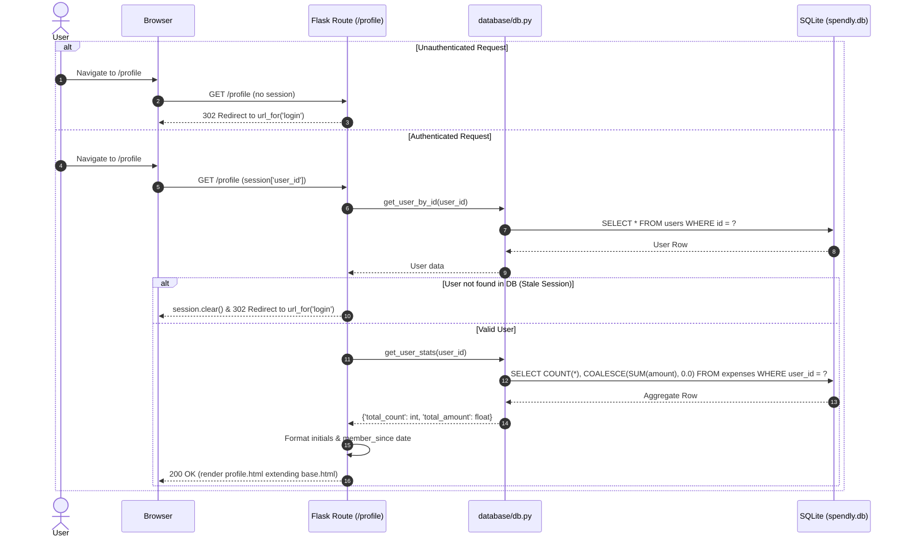

# Implementation Plan: Profile Page Design (Step 04)

## 1. Overview and Objectives

This plan details the implementation for **Step 04: Profile Page Design** of the Spendly personal expense tracker, derived from the feature specification in `.gemini/specs/04-profile-page-design.md`.

The goal is to replace the stub profile route (`GET /profile`) with a fully realized, authenticated profile dashboard. Authenticated users can review their personal identity details (name, email, membership tenure) and high-level expense statistics (total expense count, total amount spent) styled within Spendly's warm-paper, forest-green visual identity.

All modifications strictly observe the architectural constraints in `GEMINI.md`:
- SQLite access strictly encapsulated within `database/db.py` using parameterized queries (`?`).
- Single-responsibility route functions in `app.py` (fetch data, render template, done).
- Page-specific styling placed in `static/css/profile.css` without inline `<style>` tags or external CSS frameworks.
- Jinja2 templating with `url_for()` for all links and assets, extending `base.html`.
- No new pip packages or ORMs.

---

## 2. Architecture & Sequence Flow



---

## 3. Prerequisites & Dependencies

- **Step 01 (Database Setup)**: Complete. `users` and `expenses` tables exist in SQLite with appropriate schemas and foreign key constraints.
- **Step 02 (Registration)**: Complete. User accounts can be created with hashed passwords and verified.
- **Step 03 (Login and Logout)**: Complete. Sessions (`session['user_id']`, `session['user_name']`) and helper `get_user_by_id` are fully operational.
- **Roadmap Verification**: In `GEMINI.md`, `GET /profile` is marked as `Stub — Step 4`.

---

## 4. Detailed Component Plan

### 4.1. Database Layer (`database/db.py`)
Add aggregate query helper `get_user_stats`:
```python
def get_user_stats(user_id, db_path=None):
    """
    Query aggregate expense statistics for a user (total expense count and sum of amounts).
    Returns a dict with 'total_count' (int) and 'total_amount' (float).
    Handles users with zero expenses gracefully returning 0 and 0.0.
    """
```
- **Validation**: If `user_id` is missing/falsy, immediately return `{"total_count": 0, "total_amount": 0.0}`.
- **Parameterized Query**:
  ```sql
  SELECT
      COUNT(*) AS total_count,
      COALESCE(SUM(amount), 0.0) AS total_amount
  FROM expenses
  WHERE user_id = ?;
  ```
- **Connection Lifecycle**: Manage connection inside `try...finally` with `conn.close()`.

### 4.2. Route Handler (`app.py`)
Replace the stub function `@app.route("/profile")`:
1. **Authentication Check**:
   ```python
   user_id = session.get("user_id")
   if not user_id:
       return redirect(url_for("login"))
   ```
2. **Retrieve User & Validate Session**:
   ```python
   user = get_user_by_id(user_id)
   if not user:
       session.clear()
       return redirect(url_for("login"))
   ```
3. **Data Preparation**:
   - **Initials**:
     ```python
     name_parts = user["name"].strip().split()
     initials = (name_parts[0][0] + (name_parts[-1][0] if len(name_parts) > 1 else "")).upper()
     ```
   - **Member Since Date**:
     Format `user["created_at"]` using Python's `datetime.strptime` into a friendly string like `"October 19, 2026"` (with fallback to raw date string on parse failure).
   - **User Stats**:
     ```python
     stats = get_user_stats(user_id)
     ```
4. **Render Template**:
   ```python
   return render_template(
       "profile.html",
       user=user,
       initials=initials,
       member_since=member_since,
       stats=stats,
   )
   ```

### 4.3. Presentation Layer

#### Navigation Link (`templates/base.html`)
Update the logged-in branch of `.nav-links` so the user's name acts as a link to their profile:
```html

    <a href="{{ url_for('profile') }}" class="nav-user">{{ session.get('user_name') }}</a>
    <a href="{{ url_for('logout') }}">Sign out</a>

...
```

#### Profile Template (`templates/profile.html`)
- Extends `"base.html"`
- Populates `Profile — Spendly`
- Links stylesheet in ``:
  ```html
  <link rel="stylesheet" href="{{ url_for('static', filename='css/profile.css') }}">
  ```
- Semantic sections inside ``:
  - `.profile-container`: Main centered wrapper.
  - `.profile-header-card`:
    - `.avatar-badge`: Circular avatar displaying computed `{{ initials }}`.
    - `.profile-meta`: Heading with `{{ user.name }}`, paragraph with `{{ user.email }}`, and a status pill badge `"Active Member"`.
  - `.stats-grid`:
    - Card 1 (Expenses Count): Label `"Expenses Logged"`, value `{{ stats.total_count }}`.
    - Card 2 (Total Tracked): Label `"Total Spent"`, value `₹{{ '{:,.2f}'.format(stats.total_amount) }}`.
  - `.details-card`:
    - Heading: `"Account Details"`
    - Key-value list: Full Name, Email Address, Member Since (`{{ member_since }}`), Account ID.
  - `.profile-actions`:
    - Quick actions: Return home (`url_for('landing')`), Sign out (`url_for('logout')`).

#### Page-Specific Stylesheet (`static/css/profile.css`)
- Styled using existing tokens from `style.css` (`--paper`, `--paper-card`, `--ink`, `--ink-muted`, `--border`, `--accent`, `--accent-light`, `--radius-md`).
- Responsive layout with desktop two-column stats grid transitioning to single-column on mobile screens (`@media (max-width: 600px)`).

---

## 5. Test Strategy

### 5.1. Database Unit Tests (`tests/test_db.py`)
Add unit tests verifying `get_user_stats`:
1. `test_get_user_stats_empty`: User with zero expenses returns `{"total_count": 0, "total_amount": 0.0}`.
2. `test_get_user_stats_with_data`: User with multiple expenses computes exact count and sum correctly.
3. `test_get_user_stats_isolation`: Ensures expenses from other users in the database do not leak into the queried user's stats.
4. `test_get_user_stats_none_or_invalid_id`: Calling with `None` or non-existent ID safely returns zeroes without database exceptions.

### 5.2. Profile Route Integration Tests (`tests/test_profile.py`)
Create a dedicated test suite using Flask test client:
1. `test_profile_unauthenticated_redirects_to_login`: Accessing `GET /profile` with no active session returns 302 redirecting to `url_for('login')`.
2. `test_profile_authenticated_renders_200`: Accessing `GET /profile` with an active session returns 200 and loads `profile.html`.
3. `test_profile_displays_user_details_and_initials`: Validates that user name, email, initials, and member-since date are present in response HTML.
4. `test_profile_zero_expenses_display`: User with no expenses sees `0` and `₹0.00`.
5. `test_profile_aggregated_stats_display`: User with expenses sees correct count and formatted total currency (e.g., `₹1,250.00`).
6. `test_profile_stale_session_clears_and_redirects`: If `session['user_id']` references a deleted/non-existent user ID, clears session and redirects to `/login`.
7. `test_navbar_profile_link`: When logged in, navbar renders `<a ... href="/profile">` containing the user's name.

---

## 6. Step-by-Step Implementation Sequence

1. **Step 1: Database Helper & Tests**
   - Add `get_user_stats(user_id, db_path=None)` in `database/db.py`.
   - Add unit tests in `tests/test_db.py`.
   - Run `pytest tests/test_db.py` to confirm query correctness.

2. **Step 2: Profile Stylesheet**
   - Create `static/css/profile.css` with clean CSS variables and responsive rules.

3. **Step 3: Profile Template & Navbar Update**
   - Create `templates/profile.html` extending `base.html`.
   - Update `templates/base.html` to convert `.nav-user` into a link to `url_for('profile')`.

4. **Step 4: Route Implementation in `app.py`**
   - Import `get_user_stats` from `database.db`.
   - Implement `@app.route("/profile")` with session check, data formatting, and rendering.

5. **Step 5: Integration Tests**
   - Create `tests/test_profile.py` covering all positive, negative, and edge-case flows.
   - Run `pytest tests/test_profile.py`.

6. **Step 6: Full Verification**
   - Run `pytest` across the entire test suite.
   - Dispatch subagent to verify test outputs and code compliance as mandated by `GEMINI.md`.

---

## 7. Definition of Done & Verification Checklist

- [ ] `get_user_stats()` implemented in `database/db.py` using parameterized SQL (`?`) and `COALESCE(SUM(amount), 0.0)`.
- [ ] Navigating to `GET /profile` while unauthenticated returns HTTP 302 redirecting to `url_for('login')`.
- [ ] Navigating to `GET /profile` with active session returns HTTP 200 and renders `profile.html`.
- [ ] The rendered profile view shows user's name, email, formatted registration date, and initials avatar badge.
- [ ] Spending stats card accurately displays total expense count and total spend formatted with `₹` and commas.
- [ ] Stale sessions (user ID not found in database) clear the session and redirect to `url_for('login')`.
- [ ] The navigation bar in `templates/base.html` links the user's display name to `url_for('profile')`.
- [ ] All new CSS rules reside in `static/css/profile.css` and use existing CSS variables from `style.css`.
- [ ] All unit and integration tests pass cleanly with `pytest`.
