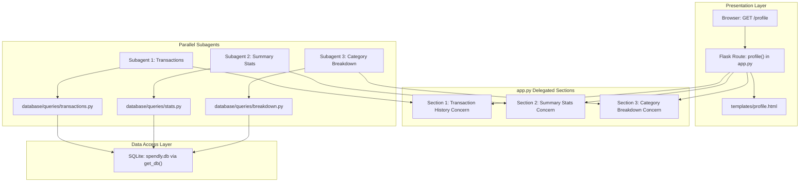

# Implementation Plan: Backend Routes for Profile Page (Step 05)

## 1. Overview and Objectives

This plan implements **Step 05: Backend Routes for Profile Page (Backend Connection)** of the Spendly personal expense tracker, derived from the feature specification in `.gemini/specs/05-backend-routes-for-profile-page.md`.

The goal is to connect all sections of the `/profile` route to live SQLite queries:
1. **User Identity & Tenure:** Display real account name, email, and formatted `member_since` ("Month YYYY").
2. **Summary Stats:** Calculate live `total_spent`, `transaction_count`, and `top_category` (with zero-expense fallback).
3. **Transaction History:** Fetch live recent expenses ordered newest-first (`date DESC, id DESC`).
4. **Category Breakdown:** Compute category totals and integer percentage widths (`pct`) that strictly sum to 100%.

As instructed, implementation will be split across **3 parallel subagents**, each responsible for its designated data concern, query helpers, and assigned section in `app.py`.

---

## 2. Architecture & Data Flow



---

## 3. Parallel Subagent Strategy & Conflict Prevention

To prevent concurrent file edit collisions on `app.py` and `database/queries.py`:

### Pre-scaffolding (Lead Agent prior to subagent launch)
1. **Directory Setup:** Create `database/queries/` with `__init__.py`.
2. **Pre-structure `app.py` with Clear Marker Sections:**
   ```python
   # --- Section 1: Transaction History (Subagent 1) ---
   # Subagent 1 wires get_recent_transactions here
   # ----------------------------------------------------

   # --- Section 2: Summary Stats & User Profile (Subagent 2) ---
   # Subagent 2 wires get_user_by_id and get_summary_stats here
   # ------------------------------------------------------------

   # --- Section 3: Category Breakdown (Subagent 3) ---
   # Subagent 3 wires get_category_breakdown here
   # --------------------------------------------------
   ```
3. Each subagent writes its query helper in its dedicated submodule and its unit tests in a dedicated test file.

---

## 4. Subagent Work Breakdown

### Subagent 1: Transaction History
- **Role:** Transaction History Engineer
- **Dedicated Query Module:** `database/queries/transactions.py`
  - Function: `get_recent_transactions(user_id, limit=10, db_path=None) -> list[dict]`
  - Query:
    ```sql
    SELECT id, amount, category, date, description
    FROM expenses
    WHERE user_id = ?
    ORDER BY date DESC, id DESC
    LIMIT ?;
    ```
  - Returns list of dicts with `id`, `amount` (float), `category`, `date`, `description`. Returns `[]` if no expenses or invalid user.
- **Assigned `app.py` Section:** Section 1 (import and invoke `get_recent_transactions(user_id, limit=10)`).
- **Dedicated Test File:** `tests/test_recent_transactions.py`
  - Test valid user with expenses (newest-first ordering, limit cutoff).
  - Test empty state returning `[]`.
  - Test user isolation (expenses from other users are excluded).

---

### Subagent 2: Summary Stats & User Profile
- **Role:** Summary Stats & Profile Engineer
- **Dedicated Query Module:** `database/queries/stats.py`
  - Functions:
    1. `get_user_by_id(user_id, db_path=None) -> dict | None`:
       - Fetches user record; formats `created_at` as `"Month YYYY"` (e.g. `"October 2026"`).
       - Returns `{"id": id, "name": name, "email": email, "member_since": formatted_date}`.
    2. `get_summary_stats(user_id, db_path=None) -> dict`:
       - Query count and sum of `amount` from `expenses` where `user_id = ?`.
       - Query top category by sum of amount:
         ```sql
         SELECT category, SUM(amount) AS cat_total
         FROM expenses
         WHERE user_id = ?
         GROUP BY category
         ORDER BY cat_total DESC, category ASC
         LIMIT 1;
         ```
       - Fallback for zero expenses: `{"total_spent": 0.0, "total_amount": 0.0, "transaction_count": 0, "total_count": 0, "top_category": "—"}`.
- **Assigned `app.py` Section:** Section 2 (import and invoke `get_user_by_id(user_id)` and `get_summary_stats(user_id)`).
- **Dedicated Test File:** `tests/test_summary_stats.py`
  - Test `get_user_by_id` valid vs non-existent.
  - Test `get_summary_stats` with expenses (exact sum, count, correct top category).
  - Test `get_summary_stats` zero expenses returns zeros and `"—"`.

---

### Subagent 3: Category Breakdown
- **Role:** Category Breakdown Engineer
- **Dedicated Query Module:** `database/queries/breakdown.py`
  - Function: `get_category_breakdown(user_id, db_path=None) -> list[dict]`
  - Query:
    ```sql
    SELECT category, COALESCE(SUM(amount), 0.0) AS total
    FROM expenses
    WHERE user_id = ?
    GROUP BY category
    ORDER BY total DESC, category ASC;
    ```
  - Calculates integer `pct = int(round((total / total_spent) * 100))`.
  - Normalizes `pct` sum: computes `remainder = 100 - sum(pct)` and absorbs remainder into largest category (first item).
  - Returns list of dicts with `name`, `category`, `amount`, `total_amount`, `pct`, `relative_pct`. Returns `[]` if no expenses.
- **Assigned `app.py` Section:** Section 3 (import and invoke `get_category_breakdown(user_id)`).
- **Dedicated Test File:** `tests/test_category_breakdown.py`
  - Test ordering descending by total amount.
  - Test integer `pct` values strictly sum to 100% across all categories.
  - Test zero expenses returns empty list `[]`.

---

## 5. Integration & UI Polish (Lead Agent)

Once all 3 subagents report completion:
1. **Module Re-export:** Wire `database/queries/__init__.py` and `database/queries.py` to expose all 4 query helpers.
2. **Template Update (`templates/profile.html`):**
   - Add the 3rd stat card for `"Top Category"` (`{{ summary_stats.top_category }}`).
   - Ensure all amounts display with `₹` symbol (e.g. `₹{{ '{:,.2f}'.format(summary_stats.total_spent) }}`).
   - Ensure backwards compatibility with existing template keys (`stats`, `recent_expenses`, `category_spending`).
3. **CSS Update (`static/css/profile.css`):**
   - Update `.profile-stats-grid` to `grid-template-columns: repeat(3, 1fr)` (with mobile responsive fallback to 1 column).
4. **Unified Test Suite (`tests/test_backend_connection.py`):**
   - Consolidate unit tests and write route tests for `GET /profile` (unauthenticated 302, authenticated seed user 200 with live values, new user with 0 transactions).
5. **Verification Subagent:** Run full pytest suite and verify all tests pass cleanly.

---

## 6. Definition of Done Checklist

- [ ] `database/queries.py` exports `get_user_by_id`, `get_summary_stats`, `get_recent_transactions`, `get_category_breakdown`
- [ ] Subagent 1 completes transaction history queries & tests
- [ ] Subagent 2 completes summary stats queries & tests (including `top_category`)
- [ ] Subagent 3 completes category breakdown queries & tests (integer `pct` sums to 100)
- [ ] `app.py` `/profile` route uses query helpers and renders dynamic data
- [ ] `templates/profile.html` renders top category, formatted currency (`₹`), recent expenses, and category bars
- [ ] All new tests in `tests/test_backend_connection.py` and existing test suites pass cleanly with `pytest`
