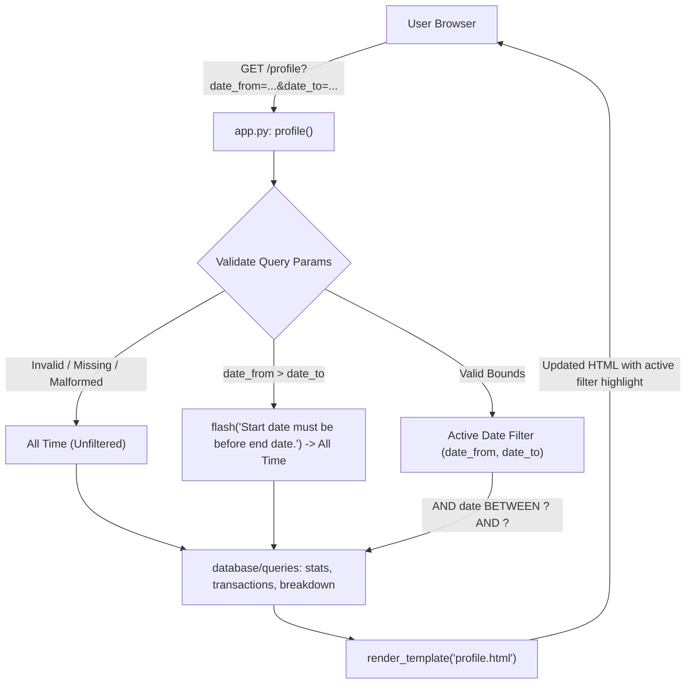

# Implementation Plan: Date Filter for Profile Page (Step 06)

## 1. Overview and Objectives

This plan implements **Step 06: Date Filter for Profile Page** of the Spendly personal expense tracker, derived from the feature specification in `.gemini/specs/06-date-filter-profile.md`.

The goal is to add a date-range filter to the existing `/profile` route so users can narrow the transaction list, summary stats, and category breakdown to a specific period:
1. **No new routes**: The filter is driven entirely by query-string parameters (`date_from` and `date_to`) on `GET /profile`.
2. **Presets**: Four quick-select preset buttons ("This Month", "Last 3 Months", "Last 6 Months", "All Time") computed dynamically in `app.py`.
3. **Custom Date Range**: Two `<input type="date">` fields and an "Apply" button.
4. **Active State Highlight**: The active preset or custom range is visually highlighted.
5. **Safe Fallbacks & Flash Messaging**: Malformed or missing dates fall back to the All Time view without crashing; `date_from > date_to` flashes `"Start date must be before end date."` and falls back to All Time view.
6. **Data Synchronisation**: All three sections (`get_summary_stats`, `get_recent_transactions`, `get_category_breakdown`) respect the filter using parameterised `AND date BETWEEN ? AND ?` queries.

---

## 2. Architecture & Data Flow



---

## 3. Files to Modify

| Target File | Changes Required |
|---|---|
| `database/queries/stats.py` | Add `date_from=None, date_to=None` to `get_summary_stats()`. Apply `AND date BETWEEN ? AND ?` to both aggregated count/sum and top-category queries when both bounds are present. |
| `database/queries/transactions.py` | Add `date_from=None, date_to=None` to `get_recent_transactions()`. Apply `AND date BETWEEN ? AND ?` before `ORDER BY date DESC, id DESC LIMIT ?`. |
| `database/queries/breakdown.py` | Add `date_from=None, date_to=None` to `get_category_breakdown()`. Apply `AND date BETWEEN ? AND ?` before `GROUP BY category ORDER BY total DESC`. |
| `app.py` | Import `flash`, `date`, `timedelta`. In `profile()`: parse & validate `date_from`/`date_to`, compute preset boundaries, detect active filter/preset, invoke queries with date params, pass state to template. |
| `templates/profile.html` | Add flashed message container, add filter bar card with preset action pills and custom date range form above the summary stats grid. Mark active state. |
| `static/css/profile.css` | Add styling for filter bar card, preset button pills, custom date inputs, submit button, active states, responsive mobile adjustments, and flash error banners using CSS variables only. |
| `tests/test_date_filter.py` | Add unit tests for query functions with date filters, and comprehensive integration tests for route behaviors and template rendering. |

---

## 4. Detailed Implementation Steps

### Phase 1: Database Query Helpers (`database/queries/`)

1. **`database/queries/stats.py` (`get_summary_stats`)**:
   - Signature: `def get_summary_stats(user_id, date_from=None, date_to=None, db_path=None):`
   - When `date_from and date_to`:
     - Append `AND date BETWEEN ? AND ?` to the count and total query:
       ```sql
       SELECT COUNT(*) AS count, COALESCE(SUM(amount), 0.0) AS total
       FROM expenses
       WHERE user_id = ? AND date BETWEEN ? AND ?;
       ```
     - Append `AND date BETWEEN ? AND ?` to the top-category query:
       ```sql
       SELECT category, SUM(amount) AS cat_total
       FROM expenses
       WHERE user_id = ? AND date BETWEEN ? AND ?
       GROUP BY category
       ORDER BY cat_total DESC, category ASC
       LIMIT 1;
       ```
   - When either bound is absent, query runs unfiltered (preserving Step 5 behavior).
   - If count is 0, safely returns default zero stats: `{"total_spent": 0.0, "total_amount": 0.0, "transaction_count": 0, "total_count": 0, "top_category": "—"}`.

2. **`database/queries/transactions.py` (`get_recent_transactions`)**:
   - Signature: `def get_recent_transactions(user_id, limit=10, date_from=None, date_to=None, db_path=None):`
   - When `date_from and date_to`:
     - Query with parameterised bounds:
       ```sql
       SELECT id, amount, category, date, description
       FROM expenses
       WHERE user_id = ? AND date BETWEEN ? AND ?
       ORDER BY date DESC, id DESC
       LIMIT ?;
       ```
       Params: `(user_id, date_from, date_to, limit)`.
   - Ordering and limit remain intact.

3. **`database/queries/breakdown.py` (`get_category_breakdown`)**:
   - Signature: `def get_category_breakdown(user_id, date_from=None, date_to=None, db_path=None):`
   - When `date_from and date_to`:
     - Query with parameterised bounds:
       ```sql
       SELECT category, COALESCE(SUM(amount), 0.0) AS total
       FROM expenses
       WHERE user_id = ? AND date BETWEEN ? AND ?
       GROUP BY category
       ORDER BY total DESC, category ASC;
       ```
       Params: `(user_id, date_from, date_to)`.
   - Percentage distribution logic and remainder absorption into the largest category remain unchanged. Returns `[]` if no expenses exist in range.

---

### Phase 2: Route Handling & Validation in `app.py`

1. **Imports**:
   - Add `flash` to Flask imports.
   - Import `date`, `timedelta` from `datetime`.

2. **Date Presets Computation**:
   Compute date strings dynamically in Python:
   - `today = date.today()`
   - **This Month**: `date_from = today.replace(day=1).isoformat()`, `date_to = today.isoformat()`
   - **Last 3 Months**: `date_from = (today - timedelta(days=90)).isoformat()`, `date_to = today.isoformat()`
   - **Last 6 Months**: `date_from = (today - timedelta(days=180)).isoformat()`, `date_to = today.isoformat()`
   - Bundle preset descriptors into a dictionary for clean template rendering.

3. **Query Parameter Parsing & Validation**:
   - Retrieve `raw_date_from = request.args.get("date_from", "").strip()` and `raw_date_to = request.args.get("date_to", "").strip()`.
   - If both parameters are provided:
     - Parse with `datetime.strptime(val, "%Y-%m-%d").date()`.
     - If `ValueError` occurs on either, treat both as `None` (silent fallback to unfiltered view).
     - If valid, check: `if d_from > d_to:`:
       - `flash("Start date must be before end date.", "error")`
       - Fall back to `None` for both bounds (unfiltered view).
     - Else: valid filter bounds confirmed (`filter_date_from = d_from.isoformat()`, `filter_date_to = d_to.isoformat()`).
   - If only one parameter is provided or neither is provided:
     - Fall back to unfiltered view (`filter_date_from = None`, `filter_date_to = None`).

4. **Active Filter Detection**:
   - Compare active bounds `(filter_date_from, filter_date_to)` against presets to set `active_preset`:
     - Matches This Month: `"this_month"`
     - Matches Last 3 Months: `"last_3_months"`
     - Matches Last 6 Months: `"last_6_months"`
     - No bounds active: `"all_time"`
     - Non-preset valid range: `"custom"`

5. **Pass Data to Template**:
   - Call query helpers with `(user_id, date_from=filter_date_from, date_to=filter_date_to)`.
   - Pass `date_from`, `date_to`, `active_preset`, and presets dictionary to `render_template`.

---

### Phase 3: Frontend Template (`templates/profile.html`)

1. **Flash Messages Block**:
   - Insert above the filter bar:
     ```html
     
       
         <div class="profile-alerts" role="alert">
           
             <div class="profile-alert profile-alert-{{ category }}">{{ message }}</div>
           
         </div>
       
     
     ```

2. **Filter Bar Section (`.filter-bar-card`)**:
   - Placed directly between User Identity Header Card and Activity Summary Stats Grid.
   - **Preset Links**:
     - "This Month" -> `url_for('profile', date_from=presets.this_month.date_from, date_to=presets.this_month.date_to)`
     - "Last 3 Months" -> `url_for('profile', date_from=presets.last_3_months.date_from, date_to=presets.last_3_months.date_to)`
     - "Last 6 Months" -> `url_for('profile', date_from=presets.last_6_months.date_from, date_to=presets.last_6_months.date_to)`
     - "All Time" -> `url_for('profile')` (clean URL, no query parameters)
     - Conditional class: `class="filter-preset-btn active"`
   - **Custom Range Form**:
     - `<form method="GET" action="{{ url_for('profile') }}" class="filter-custom-form">`
     - `<input type="date" name="date_from" value="{{ date_from or '' }}" aria-label="From date">`
     - `<span class="date-separator">to</span>`
     - `<input type="date" name="date_to" value="{{ date_to or '' }}" aria-label="To date">`
     - `<button type="submit" class="filter-apply-btn">Apply</button>`

---

### Phase 4: CSS Styling (`static/css/profile.css`)

1. **Design System & CSS Variables**:
   - Strictly adhere to Spendly design tokens defined in `style.css`:
     - `--paper-card`, `--paper-warm`, `--border`, `--border-soft`
     - `--accent`, `--accent-light`, `--ink`, `--ink-muted`
     - `--danger`, `--danger-light`, `--radius-sm`, `--radius-md`
   - No hardcoded hex values or inline styles.

2. **Components**:
   - `.filter-bar-card`: Clean card layout matching `.profile-card`.
   - `.preset-group`: Horizontal pill button group with subtle borders.
   - `.filter-preset-btn.active`: Distinct active indicator (`--accent` background with white text or `--accent-light` with `--accent` border/text).
   - `.filter-custom-form`: Aligned date inputs with clean borders, calendar icons, and styled "Apply" button.
   - Responsive adjustments: Flex wrap and vertical stacking on mobile (`@media (max-width: 768px)`).
   - `.profile-alert-error`: Distinct error callout styling (`--danger-light` background, `--danger` border and text).

---

### Phase 5: Verification & Automated Tests

1. **Unit Tests (`tests/test_date_filter.py`)**:
   - `test_get_summary_stats_filtered`: Tests stats calculation inside window, outside window, and boundary inclusive.
   - `test_get_recent_transactions_filtered`: Verifies ordering `(date DESC, id DESC)`, limit preservation, and exclusion of out-of-range rows.
   - `test_get_category_breakdown_filtered`: Verifies category percentage recalculation with 100% sum invariant over filtered records.

2. **Integration Tests (`tests/test_date_filter.py`)**:
   - Unfiltered request (`/profile`): displays all records identical to Step 5.
   - Presets: "This Month", "Last 3 Months", "Last 6 Months" apply proper filters.
   - "All Time" preset returns clean view.
   - Custom valid range (`date_from=2026-10-01&date_to=2026-10-15`): only expenses within window reflected across all 3 sections.
   - Inverted range (`date_from > date_to`): flashes error message `"Start date must be before end date."` and displays unfiltered data.
   - Malformed dates (e.g. `date_from=invalid`): does not crash, responds 200 OK, falls back to unfiltered view.
   - Out-of-range / empty date window: shows ₹0.00, 0 transactions, empty breakdown state without template errors.
   - Active preset styling: verifies active CSS class in returned HTML.

3. **Subagent Test Verification**:
   - Run the complete test suite (`pytest`) and verify via a subagent as mandated in `GEMINI.md`.

---

## 5. Definition of Done Checklist

- [ ] `GET /profile` with no query params returns unfiltered data (identical to Step 5)
- [ ] Clicking "This Month" filters summary stats, recent transactions, and category breakdown to the current month
- [ ] Clicking "Last 3 Months" filters all three sections to the 3-month window ending today
- [ ] Clicking "Last 6 Months" filters all three sections to the 6-month window ending today
- [ ] Clicking "All Time" clears query parameters and shows all expenses
- [ ] Submitting a custom date range filters all three sections to that range
- [ ] Submitting `date_from > date_to` flashes `"Start date must be before end date."` and shows unfiltered view
- [ ] Submitting malformed date parameters silently falls back to unfiltered view (no crash / 500)
- [ ] Active preset button or custom range inputs visually indicate active filter state
- [ ] All amounts retain ₹ currency formatting
- [ ] Zero expenses in range displays ₹0.00, 0 transactions, and clean empty state
- [ ] All automated tests pass with 100% compliance
