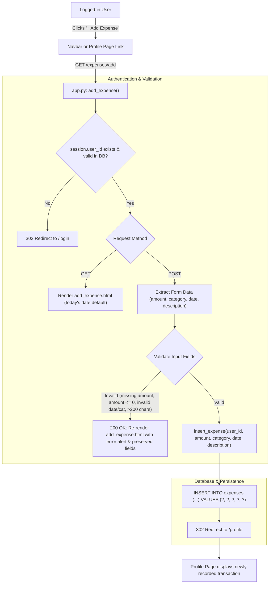

# Implementation Plan: Add Expense (Step 07)

## 1. Overview and Objectives

This plan implements **Step 07: Add Expense** of the Spendly personal expense tracker, derived from the feature specification in `.gemini/specs/07-add-expenses.md`.

The goal is to allow authenticated users to submit and track new expenses through a dedicated form page at `/expenses/add`, validate inputs server-side, persist data to SQLite, and update the UI:
1. **Route Upgrade**: Replace the GET-only placeholder at `/expenses/add` with a full GET + POST handler.
2. **Auth Protection**: Ensure both GET and POST requests to `/expenses/add` are strictly protected; unauthenticated or stale sessions redirect to `/login` (302).
3. **Data Persistence**: Add `insert_expense()` query helper in `database/queries/transactions.py` using raw parameterized SQL (`?`) with foreign key enforcement.
4. **Validation**:
   - `amount`: Required positive number (`float > 0`).
   - `category`: Required, restricted to the 7 fixed categories (`Food`, `Transport`, `Bills`, `Health`, `Entertainment`, `Shopping`, `Other`).
   - `date`: Required, strict `YYYY-MM-DD` format parsed via `datetime.strptime`.
   - `description`: Optional, whitespace-stripped, max 200 characters; stored as `NULL` if omitted.
5. **Validation Error Handling**: On validation errors, re-render the form with HTTP status **200**, display an error message, and preserve previously submitted values.
6. **Navigation & Accessibility**:
   - Add "+ Add Expense" action button on the Profile page in the Recent Transactions header row.
   - Add "Add Expense" link in the navbar visible only to logged-in users, with active state highlighting.
   - Design form page extending `base.html` using Spendly warm-paper / forest-green design tokens.
7. **Comprehensive Test Suite**: Implement unit, route, validation, and navigation tests in `tests/test_add_expense.py`.

---

## 2. Architecture & Data Flow



---

## 3. Files to Modify and Create

| Action | Target File | Description |
|---|---|---|
| **Create** | `.gemini/plans/07-add-expenses-plan.md` | Feature implementation plan documentation. |
| **Create** | `templates/add_expense.html` | Add-expense form template extending `base.html`. |
| **Create** | `static/css/add_expense.css` | Styles for form card, input adornments, and action buttons. |
| **Create** | `tests/test_add_expense.py` | Pytest test suite covering unit tests and route behaviors. |
| **Modify** | `database/queries/transactions.py` | Implement `insert_expense()` function with raw parameterized SQL. |
| **Modify** | `database/queries/__init__.py` | Re-export `insert_expense` from queries package. |
| **Modify** | `database/queries.py` | Re-export `insert_expense` in root query module. |
| **Modify** | `app.py` | Replace placeholder route with GET + POST `add_expense()` handler. |
| **Modify** | `templates/profile.html` | Add "+ Add Expense" button beside "Recent Transactions" title. |
| **Modify** | `templates/base.html` | Add "Add Expense" navbar link for authenticated users. |
| **Modify** | `static/css/profile.css` | Style `.btn-add-expense` in `.card-title-row`. |

---

## 4. Detailed Implementation Steps

### Phase 1: Database Query Helper (`database/queries/`)
1. **`database/queries/transactions.py`**:
   - Add `insert_expense(user_id, amount, category, date, description=None, db_path=None)`:
     - Open DB connection via `get_db(db_path)` ensuring foreign key enforcement.
     - Strip description and convert empty/whitespace strings to `None` (`NULL`).
     - Execute parameterized insert:
       ```sql
       INSERT INTO expenses (user_id, amount, category, date, description)
       VALUES (?, ?, ?, ?, ?);
       ```
     - Commit transaction and return `cursor.lastrowid`.
2. **Package Exports**:
   - Add `insert_expense` to `__all__` in both `database/queries/__init__.py` and `database/queries.py`.

### Phase 2: Route Handler (`app.py`)
1. **Route Definition**:
   - `@app.route("/expenses/add", methods=["GET", "POST"])`
2. **Session / Auth Verification**:
   - Check `session.get("user_id")`; if missing, redirect to `url_for("login")` (302).
   - Verify `get_user_by_id(user_id)`; if user does not exist in DB, clear session and redirect to `url_for("login")` (302).
3. **GET Handling**:
   - Compute `today = date.today().strftime("%Y-%m-%d")`.
   - Render `add_expense.html` passing `categories=CATEGORIES`, `today=today`, and empty values.
4. **POST Handling & Validation**:
   - Extract `amount_raw`, `category`, `date_raw`, `description`.
   - Validate `amount`:
     - Must not be empty.
     - Must parse as `float(amount_raw) > 0`.
   - Validate `category`:
     - Must be one of `CATEGORIES` (`Food`, `Transport`, `Bills`, `Health`, `Entertainment`, `Shopping`, `Other`).
   - Validate `date`:
     - Must parse strictly via `datetime.strptime(date_raw, "%Y-%m-%d")`.
   - Validate `description`:
     - Optional, max 200 characters.
   - If validation fails:
     - Return HTTP status **200** with `error` message and pre-filled inputs.
   - If validation succeeds:
     - Call `insert_expense(user_id=user_id, amount=amount, category=category, date=date_raw, description=description or None)`.
     - Redirect to `url_for("profile")` (HTTP 302).

### Phase 3: Templates (`templates/`)
1. **`templates/add_expense.html`**:
   - Extends `base.html`.
   - `<section class="expense-section">` with centered `.expense-card`.
   - Render `.auth-error` if `error` exists.
   - Form with `method="POST"` and `action="{{ url_for('add_expense') }}"`.
   - Number input for `amount` with currency prefix `₹`, `step="0.01"`, `min="0.01"`, and `required`.
   - `<select name="category">` with 7 fixed categories.
   - `<input type="date" name="date">` defaulting to `today`.
   - `<input type="text" name="description" maxlength="200">`.
   - Action row: "Save Expense" (`btn-save-expense`) and "Cancel" link back to `/profile` (`btn-cancel-expense`).
2. **`templates/profile.html`**:
   - In `.card-title-row` beside "Recent Transactions", add:
     ```html
     <a href="{{ url_for('add_expense') }}" class="btn-primary btn-add-expense">+ Add Expense</a>
     ```
3. **`templates/base.html`**:
   - In `.nav-links` under ``, add:
     ```html
     <a href="{{ url_for('add_expense') }}" class="active">Add Expense</a>
     ```

### Phase 4: Styles (`static/css/`)
1. **`static/css/add_expense.css`**:
   - Card layout with `--paper-card`, `--border`, `--radius-md`, subtle box shadow.
   - Currency symbol prefix `₹` positioned inside amount input.
   - Responsive actions and input styling.
2. **`static/css/profile.css`**:
   - Style `.btn-add-expense` for clean vertical alignment in `.card-title-row`.

### Phase 5: Test Suite (`tests/test_add_expense.py`)
1. **Unit Tests**:
   - `test_insert_expense_valid_data`: Confirms row insertion and retrieves values from SQLite.
   - `test_insert_expense_none_description`: Confirms `None` description is stored as `NULL`.
   - `test_insert_expense_blank_whitespace_description_stored_as_null`: Confirms whitespace strings are stored as `NULL`.
2. **Route Tests**:
   - `test_add_expense_get_unauthenticated`: 302 redirect to `/login`.
   - `test_add_expense_get_authenticated`: 200 OK, renders form with all 7 category options and default date.
   - `test_add_expense_post_unauthenticated`: 302 redirect to `/login`.
   - `test_add_expense_post_success`: 302 redirect to `/profile`, verifies new DB record and profile rendering.
   - `test_add_expense_post_success_no_description`: 302 redirect to `/profile`, confirms `NULL` description.
   - `test_add_expense_post_missing_amount`: 200 OK, error message, retains inputs.
   - `test_add_expense_post_zero_amount`: 200 OK, error message.
   - `test_add_expense_post_negative_amount`: 200 OK, error message.
   - `test_add_expense_post_non_numeric_amount`: 200 OK, error message, retains inputs.
   - `test_add_expense_post_invalid_category`: 200 OK, error message.
   - `test_add_expense_post_invalid_date`: 200 OK, error message, retains inputs.
   - `test_add_expense_post_description_too_long`: 200 OK, error message for > 200 chars.
3. **Navigation Tests**:
   - `test_profile_page_has_add_expense_button`: Profile page contains "+ Add Expense" link.
   - `test_navbar_add_expense_visibility_and_active_state`: Navbar shows link only when logged in, with `active` class on `/expenses/add`.

---

## 5. Verification & Definition of Done

- [x] Visiting `/expenses/add` while logged out redirects to `/login` (302).
- [x] Visiting `/expenses/add` while logged in displays form with amount, category, date, and description fields.
- [x] Category dropdown contains exactly: Food, Transport, Bills, Health, Entertainment, Shopping, Other.
- [x] Submitting a valid expense redirects to `/profile` and the new expense appears in the transaction list.
- [x] Submitting with missing or zero amount re-renders form with HTTP 200, error message, and retained values.
- [x] Submitting with invalid category re-renders form with HTTP 200 and error message.
- [x] Submitting with invalid date re-renders form with HTTP 200 and error message.
- [x] Submitting without description stores `NULL` in the database.
- [x] "Add Expense" button on profile page navigates to `/expenses/add`.
- [x] Navbar displays "Add Expense" link for authenticated users with active state highlighting.
- [x] Full test suite passes without regressions (143/143 tests passing).
