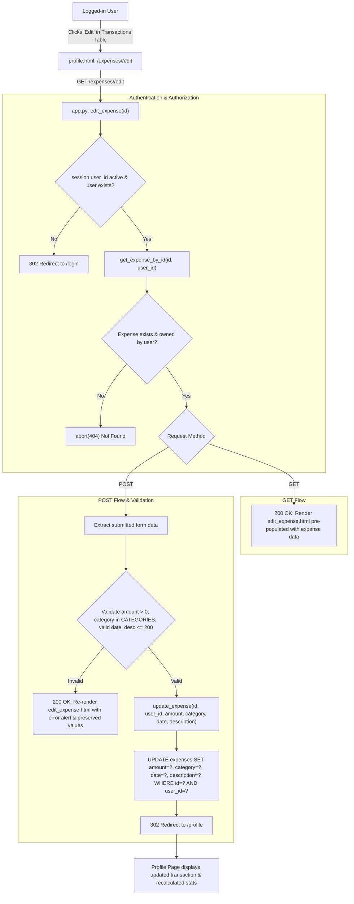

# Implementation Plan: Edit Expenses (Step 08)

## 1. Overview and Objectives

This plan implements **Step 08: Edit Expenses** of the Spendly personal expense tracker, derived from the feature specification in `.gemini/specs/08-edit-expenses.md`.

The goal is to allow authenticated users to view and update existing logged expenses through a dedicated form page at `/expenses/<int:id>/edit`, enforcing strict authorization, input validation, data persistence, and UI integration:
1. **Route Implementation**: Replace the GET-only placeholder string at `/expenses/<int:id>/edit` in `app.py` with full GET and POST handlers.
2. **Strict Authentication & Authorization**:
   - Both GET and POST requests to `/expenses/<int:id>/edit` require an active user session; unauthenticated users are redirected to `/login` (302).
   - Expenses must belong to the authenticated user (`session["user_id"]`). Attempting to edit an expense that does not exist or belongs to another user must abort with HTTP 404 (`abort(404)`).
3. **Database Query Helpers**:
   - Implement `get_expense_by_id(expense_id, user_id=None, db_path=None)` in `database/queries/transactions.py`.
   - Implement `update_expense(expense_id, user_id, amount, category, date, description=None, db_path=None)` in `database/queries/transactions.py`.
   - Re-export both helpers in `database/queries.py` and `database/queries/__init__.py`.
4. **Validation Rules**:
   - `amount`: Required positive number (`float > 0`).
   - `category`: Required, restricted to the 7 predefined categories (`Food`, `Transport`, `Bills`, `Health`, `Entertainment`, `Shopping`, `Other`).
   - `date`: Required valid date in `YYYY-MM-DD` format.
   - `description`: Optional, whitespace-trimmed, max 200 characters; stored as `NULL` if omitted or empty.
5. **Validation Error Handling**:
   - On validation errors during POST, re-render `edit_expense.html` with status code **200**, display the error alert, and preserve the user's submitted values.
6. **UI & Templates**:
   - Create `templates/edit_expense.html` extending `base.html` with pre-filled inputs, currency indicator (₹), category dropdown, and Cancel/Save buttons.
   - Create `static/css/edit_expense.css` adhering strictly to CSS variables and Spendly warm-paper / forest-green design tokens.
   - Update `templates/profile.html` to add an "ACTIONS" column header and an "Edit" button for each transaction row in the recent transactions table.
   - Update `static/css/profile.css` with styling for `.th-actions`, `.td-actions`, and `.btn-action-edit`.
7. **Comprehensive Test Suite**:
   - Implement unit, authorization, validation, and integration tests in `tests/test_edit_expense.py`.

---

## 2. Architecture & Data Flow



---

## 3. Files to Modify and Create

| Action | Target File | Description |
|---|---|---|
| **Create** | `.gemini/plans/08-edit-expenses-plan.md` | Feature implementation plan documentation. |
| **Create** | `templates/edit_expense.html` | Edit-expense form template extending `base.html`. |
| **Create** | `static/css/edit_expense.css` | Styles for edit expense page card, inputs, and actions. |
| **Create** | `tests/test_edit_expense.py` | Pytest test suite covering unit helpers, routes, auth, validation, and UI. |
| **Modify** | `database/queries/transactions.py` | Add `get_expense_by_id` and `update_expense` query functions. |
| **Modify** | `database/queries/__init__.py` | Re-export `get_expense_by_id` and `update_expense`. |
| **Modify** | `database/queries.py` | Re-export `get_expense_by_id` and `update_expense`. |
| **Modify** | `app.py` | Replace placeholder with full `edit_expense(id)` GET/POST handler and import `abort`. |
| **Modify** | `templates/profile.html` | Add "ACTIONS" column and Edit link to transactions table. |
| **Modify** | `static/css/profile.css` | Add styling for table action column and `.btn-action-edit`. |

---

## 4. Detailed Implementation Phases

### Phase 1: Database Query Helpers (`database/queries/`)
1. In `database/queries/transactions.py`:
   - Implement `get_expense_by_id(expense_id, user_id=None, db_path=None)`:
     - Query: `SELECT id, user_id, amount, category, date, description, created_at FROM expenses WHERE id = ?` (appending ` AND user_id = ?` when `user_id` is passed).
     - Return dictionary representation of expense or `None` if not found.
   - Implement `update_expense(expense_id, user_id, amount, category, date, description=None, db_path=None)`:
     - Sanitize description (strip whitespace; convert empty string to `None`).
     - Execute parameterized update:
       ```sql
       UPDATE expenses
       SET amount = ?, category = ?, date = ?, description = ?
       WHERE id = ? AND user_id = ?;
       ```
     - Return `cursor.rowcount > 0`.
2. In `database/queries/__init__.py` and `database/queries.py`:
   - Re-export `get_expense_by_id` and `update_expense` in `__all__`.

### Phase 2: Route Handler (`app.py`)
1. Import `abort` from `flask`.
2. Update `@app.route("/expenses/<int:id>/edit", methods=["GET", "POST"])`:
   - Verify user session: `user_id = session.get("user_id")`; if missing, redirect to `url_for("login")`.
   - Verify user in database with `get_user_by_id(user_id)`; if not found, clear session and redirect to `url_for("login")`.
   - Fetch expense: `expense = get_expense_by_id(id, user_id=user_id)`.
   - If not `expense`: call `abort(404)`.
   - If `request.method == "GET"`:
     - Render `edit_expense.html` passing `expense=expense`, `categories=CATEGORIES`.
   - If `request.method == "POST"`:
     - Parse `amount_raw`, `category`, `date_raw`, `description`.
     - Validate `amount`: must parse to `float > 0`.
     - Validate `category`: must be in `CATEGORIES`.
     - Validate `date`: must match `YYYY-MM-DD` via `datetime.strptime`.
     - Validate `description`: length <= 200.
     - On validation failure: render `edit_expense.html` (status 200) with `error=error`, passing submitted values to retain user inputs.
     - On validation success:
       - Call `update_expense(id, user_id, amount, category, date_raw, description)`.
       - Redirect to `url_for("profile")`.

### Phase 3: Templates and Styling
1. `templates/edit_expense.html`:
   - Extends `base.html`.
   - Card title: "Edit Expense", subtitle: "Update your transaction details".
   - Form with `method="POST"` and `action="{{ url_for('edit_expense', id=expense.id) }}"`.
   - Input fields: Amount with currency symbol ₹, Category dropdown with selected option, Date, Description, Save Changes button, Cancel link to `/profile`.
2. `static/css/edit_expense.css`:
   - Follows `add_expense.css` design system using CSS variables (`--paper-card`, `--border`, `--ink`, `--accent`, `--radius-sm`, `--radius-md`).
3. `templates/profile.html` & `static/css/profile.css`:
   - Add `<th scope="col" class="th-actions">ACTIONS</th>` to table header.
   - Add `<td class="td-actions"><a href="{{ url_for('edit_expense', id=exp.id) }}" class="btn-action-edit">Edit</a></td>` to each row.
   - Add styling in `profile.css` for `.th-actions`, `.td-actions`, and `.btn-action-edit`.

### Phase 4: Automated Testing (`tests/test_edit_expense.py`)
1. Unit tests:
   - `get_expense_by_id`: verify correct retrieval, verify `None` on wrong user ID or non-existent expense.
   - `update_expense`: verify update persistence, verify `None` description handling, verify cannot update other user's expense.
2. Route access & auth tests:
   - Unauthenticated GET and POST redirect to `/login` (302).
   - Authenticated GET and POST for non-existent expense return 404.
   - Authenticated GET and POST for another user's expense return 404.
3. Form rendering tests (GET):
   - Returns 200 with pre-filled amount, date, description, and selected category.
4. Validation and submission tests (POST):
   - Missing amount -> 200 with error message.
   - Zero or negative amount -> 200 with error message.
   - Non-numeric amount -> 200 with error message.
   - Invalid category -> 200 with error message.
   - Invalid date format -> 200 with error message.
   - Description > 200 chars -> 200 with error message.
   - Valid submission updates DB and redirects to `/profile` (302).
   - Valid submission with empty description saves NULL.
5. Integration test:
   - `/profile` transaction table contains Edit link pointing to `/expenses/<id>/edit`.

---

## 5. Verification Checklist
- [ ] Run `pytest tests/test_edit_expense.py` and verify all tests pass.
- [ ] Run full test suite `pytest` to ensure no regressions in existing tests.
- [ ] Subagent verifies test results as required by Subagent Policy in `GEMINI.md`.
