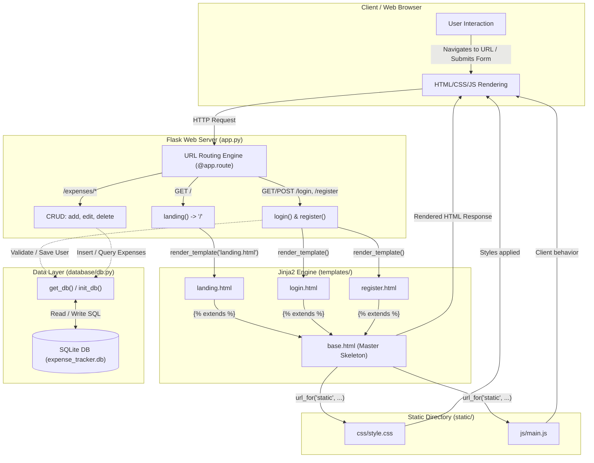

!# Spendly (SpendX) — Comprehensive Project Architecture & Documentation

## 1. Project Overview

**Spendly** (also referred to as **SpendX**) is a personal finance and expense tracking web application built with **Flask (Python)**, **Jinja2 templates**, and a custom **HTML/CSS/JavaScript** frontend.

### Primary Purpose
- Help individuals log, track, and categorize daily expenses in Indian Rupees (₹).
- Provide financial analytics, category-wise breakdowns, and monthly spending insights.
- Offer secure user authentication (registration, login, profile management, and session control).

---

## 2. Directory Structure

```text
expense-tracker/
├── .venv/                         # Python virtual environment (dependencies & interpreter)
├── file.md                        # Project documentation and architectural guide
└── expense-tracker/               # Application source directory
    ├── app.py                     # Main application entry point & route handlers
    ├── requirements.txt           # Python package dependencies
    ├── .gitignore                 # Files and folders excluded from Git version control
    ├── database/                  # Database management module
    │   ├── __init__.py            # Marks database directory as a Python package
    │   └── db.py                  # SQLite connection, initialization, and seeding
    ├── static/                    # Static frontend assets delivered directly to browser
    │   ├── css/
    │   │   └── style.css          # Design system, typography, CSS tokens, and layout
    │   └── js/
    │       └── main.js            # Client-side JavaScript for browser interactivity
    └── templates/                 # Jinja2 HTML templates
        ├── base.html              # Master layout (navbar, footer, head metadata)
        ├── landing.html           # Landing page with hero section & feature highlights
        ├── login.html             # User login form
        └── register.html          # User registration form
```

---

## 3. Main Code Breakdown: `app.py`

The primary backend controller is `app.py`. Below is the line-by-line explanation of its components:

| Line(s) | Code | Explanation |
| :--- | :--- | :--- |
| **Line 1** | `from flask import Flask, render_template` | Imports the core `Flask` application class and `render_template` function (used to parse and render Jinja2 HTML templates). |
| **Line 3** | `app = Flask(__name__)` | Instantiates the Flask web application object. `__name__` allows Flask to resolve paths for templates and static files relative to this module. |
| **Lines 10–12** | `@app.route("/")`<br>`def landing():`<br>&nbsp;&nbsp;&nbsp;&nbsp;`return render_template("landing.html")` | Binds the root URL (`/`) to the `landing()` view function, serving `landing.html` on HTTP GET requests. |
| **Lines 15–17** | `@app.route("/register")`<br>`def register():`<br>&nbsp;&nbsp;&nbsp;&nbsp;`return render_template("register.html")` | Serves the user registration interface (`register.html`). |
| **Lines 20–22** | `@app.route("/login")`<br>`def login():`<br>&nbsp;&nbsp;&nbsp;&nbsp;`return render_template("login.html")` | Serves the user sign-in interface (`login.html`). |
| **Lines 29–31** | `@app.route("/logout")`<br>`def logout():`<br>&nbsp;&nbsp;&nbsp;&nbsp;`return "Logout — coming in Step 3"` | Placeholder endpoint for clearing user session cookies and logging out. |
| **Lines 34–36** | `@app.route("/profile")`<br>`def profile():`<br>&nbsp;&nbsp;&nbsp;&nbsp;`return "Profile page — coming in Step 4"` | Placeholder endpoint for managing account profile information. |
| **Lines 39–41** | `@app.route("/expenses/add")`<br>`def add_expense():`<br>&nbsp;&nbsp;&nbsp;&nbsp;`return "Add expense — coming in Step 7"` | Placeholder endpoint for logging a new expense transaction. |
| **Lines 44–46** | `@app.route("/expenses/<int:id>/edit")`<br>`def edit_expense(id):`<br>&nbsp;&nbsp;&nbsp;&nbsp;`return "Edit expense — coming in Step 8"` | Parameterized endpoint capturing the expense's unique integer ID to edit existing records. |
| **Lines 49–51** | `@app.route("/expenses/<int:id>/delete")`<br>`def delete_expense(id):`<br>&nbsp;&nbsp;&nbsp;&nbsp;`return "Delete expense — coming in Step 9"` | Parameterized endpoint capturing the expense's unique integer ID to delete a transaction. |
| **Line 54** | `if __name__ == "__main__":` | Standard Python guard ensuring the server only runs when executed directly, not when imported. |
| **Line 55** | `app.run(debug=True, port=5001)` | Starts the local web server on port `5001` with debug mode enabled (automatic reload upon file changes and interactive browser tracebacks). |

---

## 4. Dependencies & `requirements.txt`

The `requirements.txt` file locks external libraries required by this project:
- **`flask==3.1.3`**: Lightweight WSGI web application framework managing HTTP requests, URL routing, and template rendering.
- **`werkzeug==3.1.6`**: Core utility library behind Flask. Provides HTTP utilities, routing engine, and cryptographic password hashing (`generate_password_hash`, `check_password_hash`).
- **`pytest==8.3.5`**: Python test framework for writing and executing unit and integration tests.
- **`pytest-flask==1.3.0`**: Pytest extension offering fixtures and helpers tailored for Flask application testing.

---

## 5. Frontend & Asset Architecture

### Jinja2 Template Inheritance
Flask uses Jinja2 templating to eliminate duplicate code across web pages:
1. **`templates/base.html` (Master Template)**:
   - Houses common HTML elements: `<head>`, external typography (`DM Serif Display` & `DM Sans`), navigation bar, and footer.
   - Declares block hooks that child templates populate:
     ```jinja2
     Spendly
     
     
     ```
2. **Child Templates (`landing.html`, `login.html`, `register.html`)**:
   - Begin with ``.
   - Inject specific UI components into ``.

### Static Assets (`static/`)
Static files are served directly to the browser without server-side modification:
- **`static/css/style.css`**: Defines design tokens (CSS variables like `--paper`, `--ink`, `--accent`), typography rules, navigation styles, form inputs, and responsive layout grids.
- **`static/js/main.js`**: Client-side JavaScript executed directly by the user's browser for dynamic interactions.
- Linked inside `base.html` via Flask's URL generator:
  ```html
  <link rel="stylesheet" href="{{ url_for('static', filename='css/style.css') }}">
  <script src="{{ url_for('static', filename='js/main.js') }}"></script>
  ```

---

## 6. Database Layer: `database/db.py`

### What is the Database?
A database provides permanent, structured storage on disk so data persists across server restarts. This project uses **SQLite**, which requires no separate database server and stores all tables in a single local file (`expense_tracker.db`).

### Schema Design
1. **`users` Table**:
   - `id`: INTEGER PRIMARY KEY AUTOINCREMENT
   - `name`: TEXT NOT NULL
   - `email`: TEXT UNIQUE NOT NULL
   - `password_hash`: TEXT NOT NULL
   - `created_at`: TIMESTAMP DEFAULT CURRENT_TIMESTAMP

2. **`expenses` Table**:
   - `id`: INTEGER PRIMARY KEY AUTOINCREMENT
   - `user_id`: INTEGER NOT NULL (Foreign Key referencing `users(id)`)
   - `amount`: REAL NOT NULL
   - `category`: TEXT NOT NULL (e.g., Food, Bills, Transport, Health)
   - `date`: TEXT NOT NULL
   - `description`: TEXT
   - `created_at`: TIMESTAMP DEFAULT CURRENT_TIMESTAMP

### Helper Functions in `db.py`
- **`get_db()`**: Creates or returns a connection to SQLite with `PRAGMA foreign_keys = ON` and `row_factory = sqlite3.Row`.
- **`init_db()`**: Executes SQL schema definition (`CREATE TABLE IF NOT EXISTS`) to initialize tables.
- **`seed_db()`**: Inserts default test categories and demo expense entries for development.

---

## 7. System Architecture & Connection Flow



---

## 8. Request-Response Lifecycle Example (Visiting `/`)

1. **User Request**: The user enters `http://127.0.0.1:5001/` in their web browser.
2. **Route Match**: Flask inspects incoming routes and executes the `landing()` function in `app.py`.
3. **Template Compilation**:
   - `landing()` calls `render_template("landing.html")`.
   - Jinja2 loads `landing.html`, detects ``, and injects page content into the base layout.
   - Jinja2 resolves `url_for('static', filename='css/style.css')` into `/static/css/style.css`.
4. **HTTP Response**: The web server returns the compiled HTML document with status code `200 OK`.
5. **Asset Fetching**: The browser downloads the referenced CSS (`style.css`) and JavaScript (`main.js`) from the `static/` directory.
6. **Page Render**: The browser applies styling and displays the Spendly landing page.
